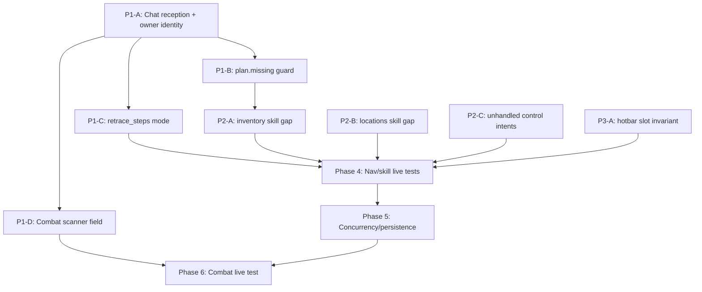

# 07 — Repair Order for Codex
**Commit:** `97f0ba6016b170eb48762b1651481f5051e1bbd1`

This is a **dependency-aware phased repair plan for Codex**. Antigravity does not implement these repairs.

---

## Guiding Principle

Do not repair advanced autonomous features before confirming the basic command pipeline works end-to-end. A broken basic pipeline means every advanced test is unreliable.

**Start → verify → expand.** Each phase ends with an observable acceptance test.

---

## Phase 1 — Establish Observable Command Execution Chain

**Goal:** Any simple command typed in Minecraft chat by the owner produces a correct in-game response.

### P1-A: Verify Owner Identity and Chat Reception

**Files:** `index.js`, `src/modules/commands/adapters/MinecraftChatAdapter.js`, `.env`

Tasks:
1. Add stage logging to `MinecraftChatAdapter._handlePlayerMessage`: log receipt, online-player check result, and whether message is passed to gateway
2. Confirm `OWNER_USERNAME` env var is set and matches the in-game username exactly (case-sensitive matters for RBAC)
3. Test: Owner types `status` → check log shows "received → passed to gateway"

**Finding addressed:** F10 (investigation lead)
**Acceptance:** `status` produces a reply; log shows full receipt chain

### P1-B: Fix `plan.missing` Guard Before Dispatch

**File:** `src/modules/commands/UnifiedCommandGateway.js`

Tasks:
1. After `plan.ambiguities` check, add:
   ```javascript
   if (plan.missing && plan.missing.length > 0) {
     return CommandResponse.error(`Missing prerequisites: ${plan.missing.join('; ')}`);
   }
   ```
2. Add unit test: command with unregistered location produces error, not enqueue

**Finding addressed:** F03
**Acceptance:** `go home` without a registered base returns a clear error, not a task failure

### P1-C: Fix `retrace_steps` Mode Dispatch

**File:** `src/modules/commands/CommandPlanner.js`

Tasks:
1. In `_buildOperation()`, add:
   ```javascript
   if (intentName === 'retrace_steps') {
     params.mode = 'retrace_steps';
   }
   ```
2. Add test: `retrace_steps` intent produces `params.mode === 'retrace_steps'`
3. Confirm `NavigationService.retracePath()` exists and has an implementation

**Finding addressed:** F05
**Acceptance:** `retrace steps` → NavigationSkill runs `retrace` mode, not `go_home`

### P1-D: Fix Combat Scanner Task Field Reference

**File:** `index.js`

Tasks:
1. Change combat scan from:
   ```javascript
   const currentTask = botContext.taskManager && botContext.taskManager.currentTask;
   ```
   to:
   ```javascript
   const currentTask = (botContext.taskManager && botContext.taskManager.activeTask) || botContext.currentTask;
   ```
2. Add test/log: when a task is active, combat scan correctly yields

**Finding addressed:** F04
**Acceptance:** Combat scan correctly skips when a task is active (verify with log)

---

## Phase 2 — Fix Broken Dispatch (Unregistered Skills)

**Goal:** No command throws "skill not registered" unless intentionally unimplemented.

### P2-A: Resolve `inventory` Skill Gap

**Files:** `src/modules/commands/CommandSchemas.js`, `src/modules/commands/UnifiedCommandGateway.js`, `src/modules/inventory/inventory.service.js`

Option A — Add `isControl:true` to inventory management commands and implement handlers in `executeControlOperation`:
```javascript
case 'sort_inventory':
  await ctx.inv.organizeHotbar(); // or dedicated sort
  return CommandResponse.success('Inventory sorted.');
case 'store_all':
  // route to logistics.service or inventory.service
case 'store_item':
  // ...
```

Option B — Create a new `InventorySkill` class and register it in `SkillRegistry`.

Tasks:
1. Decide on routing strategy (control vs skill)
2. Implement handlers for: `sort_inventory`, `store_all`, `store_item`, `retrieve_item`, `drop_item`, `drop_all`
3. Add unit tests per handler with mock inventory
4. Add acceptance test: `sort inventory` → bot sorts, no error

**Finding addressed:** F01 (inventory subset)

### P2-B: Resolve `locations` Skill Gap

**Files:** `src/modules/commands/CommandSchemas.js`, `src/modules/commands/UnifiedCommandGateway.js`, `src/modules/navigation/locations.repository.js`

Tasks:
1. Add `isControl:true` handlers for all location commands:
   - `register_base`, `register_farm`, `register_mine`, `set_waypoint` → `ctx.locations.registerLocation(name, pos, type)`
   - `remove_waypoint` → `ctx.locations.deleteLocation(name)` (dangerous, keep confirmation)
2. Already `isControl:true`: `list_bases`, `list_farms`, `list_mines`, `list_waypoints` → add switch cases calling `ctx.locations.listByType(type)`

**Finding addressed:** F01 (locations subset), F02 (listing commands)

### P2-C: Fix All Remaining Unhandled Control Intents

**File:** `src/modules/commands/UnifiedCommandGateway.js`

For each unhandled control intent in `CommandSchemas.js`, implement one of:
- A real handler (data from ctx)
- An explicit "not yet implemented" error response

Priority order:
1. `queue` → `taskManager.getQueueSnapshot()`
2. `cancel` → `taskManager.cancelTask(params.taskId)` or most recent task
3. `who_has_access` → `permissions.listUsers()`
4. `security_log` → query CommandAudit model
5. `list_bases` / `list_farms` / `list_mines` / `list_waypoints` → `locations.listByType()`
6. `quiet_mode_on/off`, `dnd/dnd_off` → messageRouter quiet mode flag
7. `show_macro` → Macro.findOne({ name })
8. `delete_macro` → Macro.deleteOne({ name }) (dangerous)

**Finding addressed:** F02
**Acceptance:** `queue` shows current queue; `list bases` shows registered bases

---

## Phase 3 — Strengthen Hotbar/Inventory Invariants

**Goal:** Safety-critical invariants are verifiable, not assumed.

### P3-A: Fix Water Bucket Slot Verification

**File:** `src/modules/mining/mining.skill.js`

Tasks:
1. After `organizeHotbar()`, add explicit slot check:
   ```javascript
   const hotbarSlot6 = this.ctx.bot.inventory.slots[36 + 6]; // window slot for hotbar 6
   const hasWaterInSlot6 = hotbarSlot6 && hotbarSlot6.name === 'water_bucket';
   if (!hasWaterInSlot6 && targetY < 0) {
     throw new SkillAbort('Water bucket is not in hotbar slot 6. Hazardous mining aborted.');
   }
   ```
2. Update test to check actual slot, not just possession

**Finding addressed:** F08
**Acceptance:** Mining below Y=0 without bucket in slot 6 aborts; with bucket, proceeds

---

## Phase 4 — Navigation and Skill Live Verification

**Goal:** At least one skill produces an observable in-game effect end-to-end.

Tasks (in order):
1. `follow me` → bot follows owner (verify: bot entity moves in-game)
2. `register base myBase` → bot registers current position (verify: `list bases` shows myBase)
3. `go home` → bot navigates to myBase (verify: bot arrives)
4. `mine 10 coal` → bot mines coal blocks (verify: coal in inventory, blocks gone)
5. `craft wooden_pickaxe` → bot crafts (verify: pickaxe in inventory)

---

## Phase 5 — Concurrency and Persistence Hardening

**Goal:** Queue persistence and cancellation are reliable.

### P5-A: Concurrency Risk in cancelTask (Finding F06)

Tasks:
1. Test: start a 10-second navigation, cancel immediately, start another task
2. Verify prior navigation goal is cleared (pathfinder goal = null)
3. If races occur, add await or drain mechanism before clearing activeTask

### P5-B: Queue Persistence Ordering (Finding F07)

Tasks:
1. Add debounced or sequenced `_persistQueue()` (e.g., use a promise chain or write-lock)
2. Test: rapid enqueue/complete cycle → `task_queue.json` is consistent after each cycle

---

## Phase 6 — Advanced Autonomous Features

**Prerequisites:** Phases 1–5 fully accepted.

Features to validate:
- Farming (harvest + replant loop)
- Combat (threat detection, tactical maneuvers, retreat)
- Building (schematic execution)
- Logistics (warehouse indexing, sorting)
- Ambient behaviors (auto-eat, bed sleep)

Each requires a live Minecraft acceptance test per `06_RUNTIME_BASELINE_AND_TESTS.md` Phase 4–5 checklist.

---

## Dependency Graph


