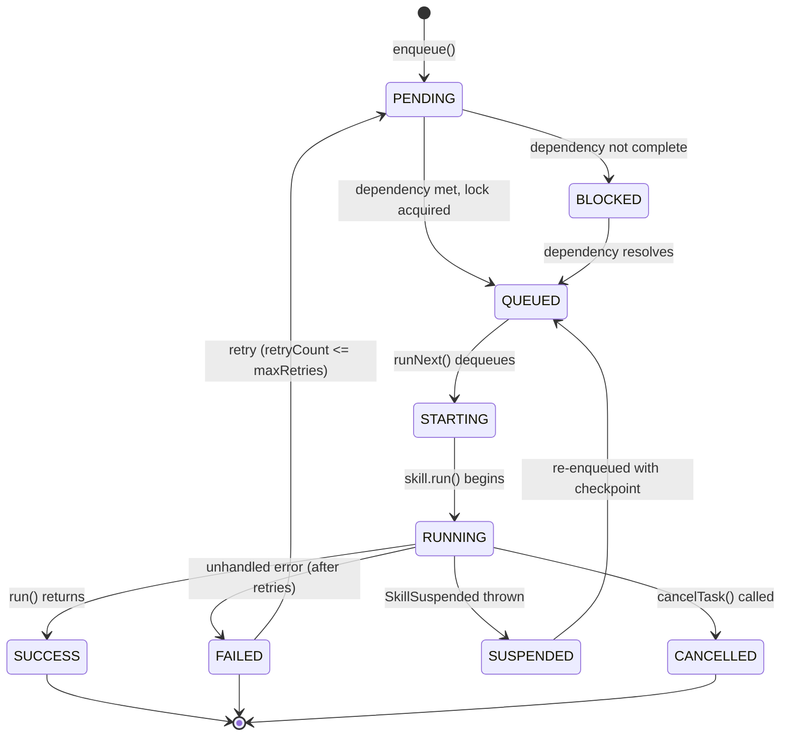
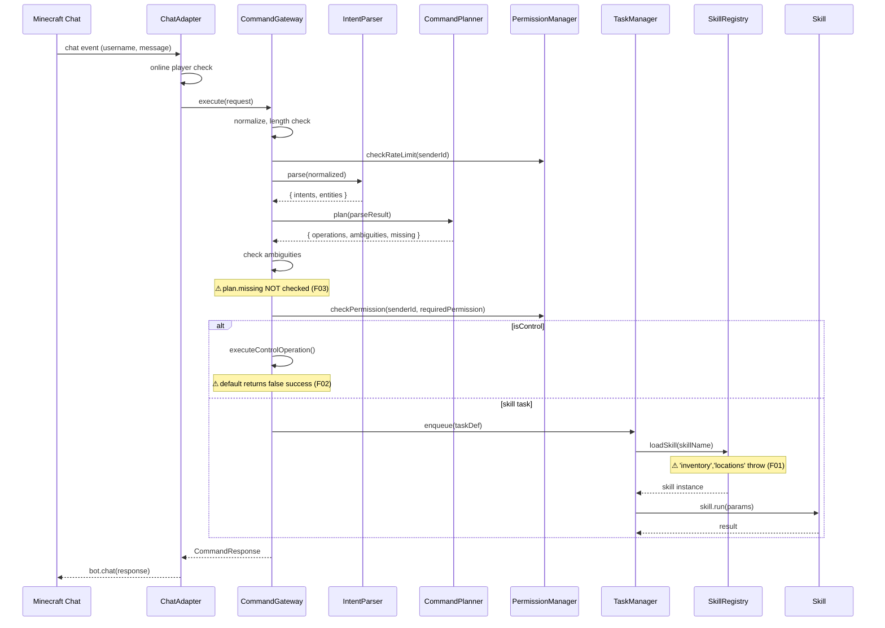

# Mermaid Diagrams — Source-Based Architecture Diagrams

This folder contains architecture diagrams in Mermaid format, all grounded in the actual source code at commit `97f0ba6016b170eb48762b1651481f5051e1bbd1`.

---

## Available Diagrams

### In [`01_SYSTEM_ARCHITECTURE.md`](../01_SYSTEM_ARCHITECTURE.md)

**Diagram 1: High-Level Component Map** (flowchart TD)
Shows the full flow from Minecraft Server → MinecraftChatAdapter → UnifiedCommandGateway → TaskManager → SkillRegistry → Skills → Mineflayer APIs.

**Diagram 2: BotContext DI Container** (described in table form)
All service references and their types.

### In [`07_REPAIR_ORDER_FOR_CODEX.md`](../07_REPAIR_ORDER_FOR_CODEX.md)

**Diagram 3: Phase Dependency Graph** (flowchart TD)
Shows which repair phases must complete before others can begin.

---

## To Render These Diagrams

Paste any `mermaid` code block into:
- [https://mermaid.live](https://mermaid.live)
- VS Code with Mermaid Preview extension
- Any Markdown renderer supporting Mermaid

---

## Task State Machine (Additional Diagram)

## Command Pipeline Sequence

